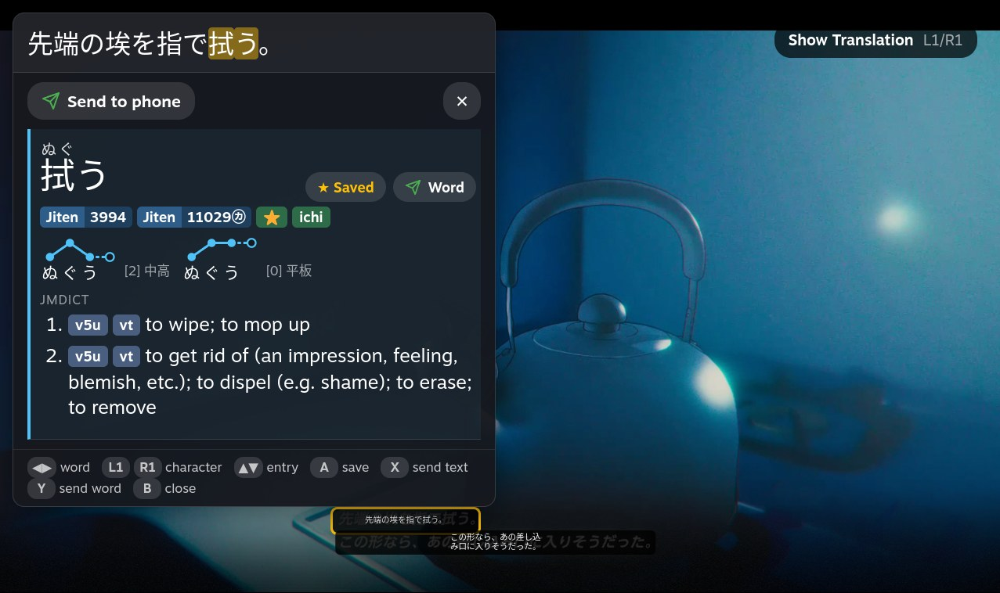
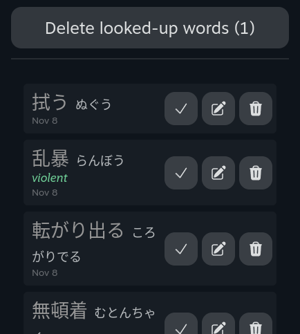
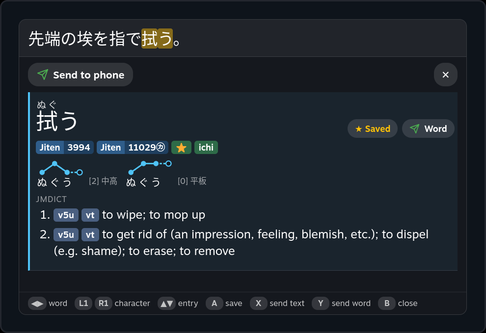
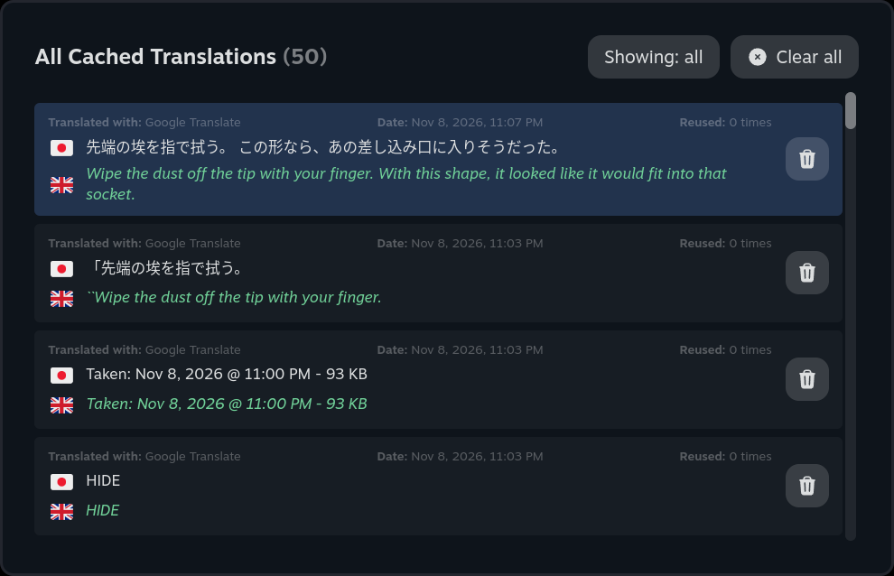
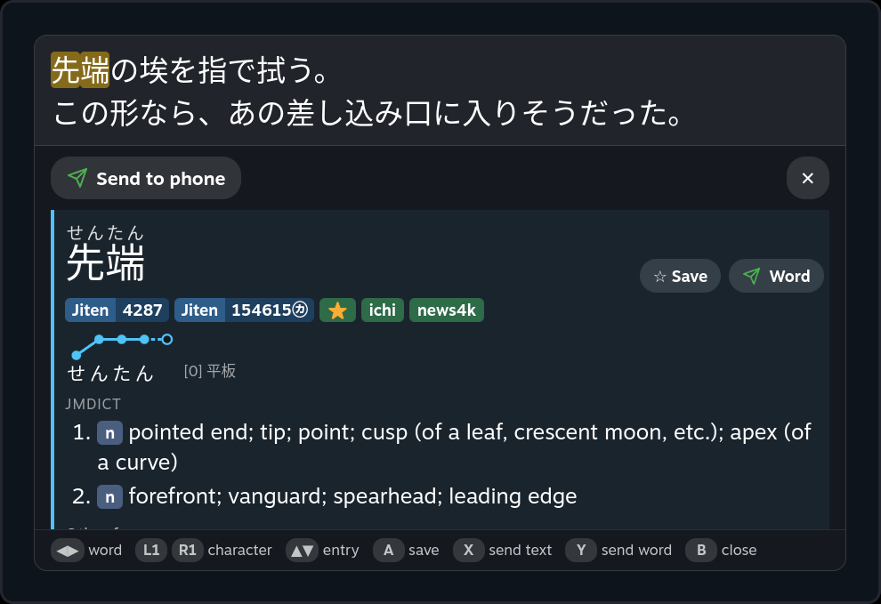

# decky-ocr-notify

**A fork of [Decky Translator](https://github.com/cat-in-a-box/Decky-Translator) tuned for learning Japanese.**

Decky Translator is a [Decky Loader](https://github.com/SteamDeckHomebrew/decky-loader) plugin by cat-in-a-box that captures your Steam Deck screen, recognizes the text with OCR, translates it and shows the result in an overlay. All of that comes from the original project. This fork adds a Yomitan-style dictionary on top, so you can read Japanese games and look up words without leaving them, plus ways to send words to your phone or save them for later.

## What this fork adds

- **Dictionary lookup on the overlay.** Tap a text box (or press A on it) to open its text in a Yomitan-style popup with readings, furigana, definitions, frequency ranks and conjugation (食べさせられなかった → 食べる).
- **Pitch accent graphs.** Each word shows its accent the way most dictionaries draw it: high and low dots joined by lines, with a hollow dot for the following particle and the pattern name (平板, 頭高, 中高, 尾高).
- **Bookmarks.** ☆ Save a word (or press A) to look it up later. The Bookmarks tab reopens it in the sentence it came from, and lets you add a note, mark it looked up and delete it.
- **Send to phone with ntfy.** Send a whole text box, or just one word in its dictionary form. Tapping a word notification opens it in a phone dictionary such as Shirabe Jisho.
- **Cached translations open in the dictionary.** Translation → View Cached Translations: tap an entry or press A to look up words in its original text.
- **Full controller navigation** of the overlay and the dictionary, with the D-pad or either stick.
- **One-step dictionary install:** JMdict, JMnedict, Jiten frequency and a bundled Kanjium pitch accent dictionary. Any other Yomitan dictionary can be added from a .zip.
- **Deploy from a PC** to the Deck over SSH, staying in Game Mode.

## Screenshots

Tap a text box on the overlay to look its words up, with pitch accent graphs, frequency ranks and definitions:



<table>
  <tr>
    <td width="34%"></td>
    <td></td>
  </tr>
  <tr>
    <td align="center">Bookmarks tab</td>
    <td align="center">A bookmark reopened in its original sentence</td>
  </tr>
</table>

<table>
  <tr>
    <td></td>
    <td></td>
  </tr>
  <tr>
    <td align="center">Cached translations</td>
    <td align="center">Opened in the dictionary</td>
  </tr>
</table>

## Requirements

- Steam Deck (LCD or OLED)
- [Decky Loader](https://github.com/SteamDeckHomebrew/decky-loader) installed
- Internet for web-based OCR/translation providers and for the first download of dictionaries and offline models
- For send to phone: the [ntfy](https://ntfy.sh/) app on your phone and a topic to send to

## Installation

This fork is not in the Decky plugin store. Install it from its release zip:

1. **Download [`decky-ocr-notify.zip`](https://github.com/JasonHiew/decky-ocr-notify/releases/latest/download/decky-ocr-notify.zip)** from the [latest release](https://github.com/JasonHiew/decky-ocr-notify/releases/latest). Don't unzip it.
2. **Get it onto the Deck**, for example into Downloads: download it there with a browser in Desktop Mode, or copy it from a PC with `scp decky-ocr-notify.zip deck@<deck-ip>:~/Downloads/`.
3. Press <picture><source media="(prefers-color-scheme: dark)" srcset="assets/icons/light/qam.svg"></picture>, open the Decky tab <picture><source media="(prefers-color-scheme: dark)" srcset="assets/icons/light/plug.svg"></picture> and open its settings <picture><source media="(prefers-color-scheme: dark)" srcset="assets/icons/light/gear.svg"></picture>.
4. In **General**, turn on **Developer Mode**. Then open **Developer** → **Install Plugin from ZIP file** → **Browse**, and pick `decky-ocr-notify.zip`.

On first install Decky downloads the plugin's Python dependencies (about 180 MB), the same ones Decky Translator uses.

- **It replaces Decky Translator.** The plugin still installs as "Decky Translator", so it takes the place of the original if you had it. Your settings carry over.
- **Don't update it from the Decky store.** The store sees the plugin as Decky Translator and may offer the original's version as an update, which would replace this fork. To update the fork, install the newer release zip the same way.
- To try changes from source, [deploy from a PC](#updating-the-deck-from-a-pc) instead.

## Using it

1. Open the plugin and press **Translate**, or hold **L4** for a quick translation. Hold L4 again to close the overlay. The button can be changed in the Controls tab.
2. Tap a text box on the overlay, or pick it with the D-pad and press A, to open it in the dictionary.
3. In the dictionary, tap any character to look up the longest word starting there.

## Dictionary

The popup shows the box's recognized text at the top; tap a character to look up from there. Results show readings, furigana, pitch accent, frequency ranks and definitions. Tapping a word inside a definition looks it up too (Back returns).

- **Install dictionaries** from the Dictionary tab in one step: JMdict (English), JMnedict (names), Jiten frequency and Kanjium pitch accents. That is about 35 MB to download and 230 MB on disk. The Kanjium pitch dictionary ships inside the plugin, so it installs without downloading. Other Yomitan-format dictionaries can be added from a [.zip file](#installing-a-dictionary-from-a-zip) or a URL.
- Dictionaries can be reordered, disabled, deleted and updated. Updatable ones are checked automatically (weekly by default). Downloads show their size, speed and time left, and retry if the connection stalls.
- **Learning aids** (Dictionary tab): **Show romaji** adds romaji under each reading and under the pitch graph's syllables, and **Hiragana / katakana chart** opens a kana table with romaji.
- **Pitch accent** is drawn as a graph under the word: a dot per mora, high or low, joined by lines so each rise or drop is a diagonal. The hollow dot after the word is the following particle (が, は). It tells 平板 (stays high: はし [0] 端) from 尾高 (drops onto the particle: はし [2] 橋). The number is the mora the pitch drops after.

### Installing a dictionary from a .zip

Any dictionary made for [Yomitan](https://github.com/yomidevs/yomitan) works: term dictionaries (definitions), frequency lists and pitch accent dictionaries. Collections of them include the [learnjapanese.moe Yomitan guide](https://learnjapanese.moe/yomichan) and [MarvNC's yomitan-dictionaries](https://github.com/MarvNC/yomitan-dictionaries). For example, the guide's Pitch Accent folder has アクセント辞典v2, which covers more words than Kanjium.

1. **Get the .zip onto the Deck**, into the Downloads folder (`/home/deck/Downloads`). Don't unzip it. Either:
   - in Desktop Mode, download it with a browser, which saves to Downloads; or
   - from a PC on the same network, copy it over SSH (the same setup as [deploying from a PC](#updating-the-deck-from-a-pc)):
     ```bash
     scp "アクセント辞典v2.zip" deck@192.168.0.42:~/Downloads/
     ```
2. Open the plugin's **Dictionary** tab → **Add Dictionaries** → **Import from file**, and pick the .zip. The file picker opens in Downloads.
3. Wait for the import to finish (the Status section shows progress). The new dictionary is used in lookups straight away.

If the dictionary has a direct download link, **Install from URL** does the same without copying a file. Links to a dictionary's index `.json` also enable automatic updates.

With more than one pitch dictionary installed, each accent is drawn once even if several dictionaries list it. Reorder, disable or delete dictionaries under **Installed Dictionaries**.

### Bookmarks

Press **☆ Save** on an entry (or A with a controller) to save the word. It turns into ★ Saved; press it again to remove it.

The **Bookmarks** tab lists saved words:

- **Open:** tap a word or press A to open it in the dictionary, in the sentence it was saved from.
- **✓ Looked up:** marks it done (struck through). ↩ undoes it. "Hide looked-up words" hides them.
- **✎ Note:** add or edit a note.
- **🗑 Delete:** one word, or **Delete looked-up words** for all done ones at once (press twice to confirm).
- **Add a word:** type a word to save it without a lookup.

Bookmarks are stored separately from the translation cache, with their own copy of the sentence, so clearing cached translations does not affect them.

### Controller

Controller navigation can be turned off under Controls → Controller Navigation (useful if the game reacts to the buttons). The sticks work like the D-pad and repeat while held.

| Where | Button | Action |
|-------|--------|--------|
| Overlay | D-pad or either stick | Pick a text box |
| Overlay | A | Open the dictionary for the picked box |
| Overlay | L1 / R1 | Switch the boxes between original and translated text |
| Overlay | B | Clear the selection |
| Dictionary | ◀ ▶ (D-pad or stick) | Previous / next word |
| Dictionary | L1 / R1 | Move the lookup one character |
| Dictionary | ▲ ▼ (D-pad or stick) | Pick an entry |
| Dictionary | A | Save or unsave the picked entry's word |
| Dictionary | X | Send the box's text to your phone |
| Dictionary | Y | Send the picked entry's word (dictionary form only) |
| Dictionary | B | Back after following a cross-reference, otherwise close |
| Dictionary | Select | Move the popup to the other side (also the ⇄ button); in the Wide size, between top and bottom (⇅) |
| Dictionary | Start | Change the popup size: ½, ⅓ or ⅔ of the screen's width, or Wide: full width and about half the height, at the top or bottom, so captions stay visible. Remembered for next time |

The same controls work in the dictionary opened from the Bookmarks tab and from cached translations.

## Sending to your phone (ntfy)

Set it up under Controls → Notifications (ntfy) → **Configure ntfy**: the server URL (for example `https://ntfy.sh`), your topic, an optional access token, and the **Word link**. Subscribe to the same topic in the ntfy app on your phone.

- **Send to phone** (X) sends the whole text box.
- **Word** (Y) sends just the word in its dictionary form (行ってしまった → 行く). Tapping the notification opens the **Word link** with that word.

Nothing is sent by tapping a box; sending is always an explicit button.

### Opening words in a phone dictionary

The Word link is a link template where `{word}` is replaced by the word. ntfy attaches it to the notification as its click action, so tapping the notification opens it. Configure ntfy has two presets:

| Preset | Link | Phone |
|--------|------|-------|
| Shirabe Jisho (default) | `shirabelookup://search?w={word}` | iPhone ([Shirabe Jisho](https://apps.apple.com/app/id1005203380) is iOS only) |
| Jisho.org | `https://jisho.org/search/{word}` | Any phone, opens in the browser |

Any other app or site that accepts the word in a link works too; type its link with `{word}` in it. On Android, a dictionary app's deep link works the same way if the app registers one.

If Shirabe searches the clipboard instead of the word, turn off its "search clipboard on open" setting; it can win over the link depending on how Shirabe was opened.

**Optional, iPhone: open Shirabe without tapping** (iOS 27 notification automations). In Shortcuts → Automation, add "When I receive a notification from ntfy". Turn **Automation** on and **Notify** off, so it runs without asking. Then add **Open URLs** `shirabelookup://search?w=` followed by the notification's **Body**. This runs for every ntfy notification, including "Send to phone" sentences, so add a filter (Add Filter) if those go to the same topic. Opening an app from an automation may only work while the phone is unlocked.

## Updating the Deck from a PC

`tools/deploy-to-deck.sh` builds the plugin and copies its code to the Deck over SSH, keeping the dependencies already installed there. Decky reloads the plugin automatically, so the Deck can stay in Game Mode. The plugin has to be [installed](#installation) once first, which puts its dependencies on the Deck.

One-time setup on the Deck (Desktop Mode, Konsole): set a password with `passwd` and enable SSH with `sudo systemctl enable --now sshd`. The first deploy asks for the password once more to turn on hot reload for the plugin.

```bash
tools/deploy-to-deck.sh 192.168.0.42
```

From cmd or PowerShell on Windows, `tools\deploy-to-deck.cmd 192.168.0.42` runs the same script through Git Bash. The host can also come from the `DECK_HOST` environment variable. Options: `--no-build`, `--sudo` (if the plugin files are root-owned), `--dry-run`.

To skip the password on every deploy, add an SSH key once (PowerShell):

```powershell
ssh-keygen -t ed25519 -f $HOME\.ssh\id_ed25519 -N '""'
type $HOME\.ssh\id_ed25519.pub | ssh deck@192.168.0.42 "mkdir -p ~/.ssh && chmod 700 ~/.ssh && cat >> ~/.ssh/authorized_keys && chmod 600 ~/.ssh/authorized_keys"
```

## Translation and OCR

The rest of this README describes the translation side, which comes from Decky Translator unchanged.


### How does it do that?

Decky Translator allows you to choose different Text Recognition and Translation methods - feel free to experiment.

### Text Recognition (OCR)

| Provider                                                                                               | Type      | Description                                                                                            | Requirements              |
|--------------------------------------------------------------------------------------------------------|-----------|--------------------------------------------------------------------------------------------------------|---------------------------|
| [**Chrome Screen AI**](https://source.chromium.org/chromium/chromium/src/+/main:services/screen_ai/)   | On-device | OCR using Chromium's screen-ai library. The best recognition quality available                         | One-time 120 MB download  |
| [**RapidOCR**](https://github.com/RapidAI/RapidOCR)                                                    | On-device | OCR using PP-OCRv5 ONNX models. Alternative solution for on-device recognition                         | One-time 75 MB download   |
| [**Gemini Vision**](https://ai.google.dev/gemini-api)                                                  | Web       | Recognition and translation in a single API call. Best for stylized/in-game text, but is not very fast | Internet + API key        |
| [**OCR.space**](https://ocr.space/)                                                                    | Web       | Free EU-based Cloud OCR API with some usage limitations. Good choice if you don't translate very often | Internet                  |
| [**Google Cloud Vision**](https://cloud.google.com/vision)                                             | Web       | High accuracy and speed. Great for complex text. Has a great free tier, but requires some setup        | Internet + API key        |

### Translation

| Provider                                                                                     | Type      | Description                                                                                                                          | Requirements                |
|----------------------------------------------------------------------------------------------|-----------|--------------------------------------------------------------------------------------------------------------------------------------|-----------------------------|
| [**NLLB-200**](https://huggingface.co/facebook/nllb-200-distilled-1.3B)                      | On-device | Meta's NLLB-200 1.3B distilled model running locally via CTranslate2. Fully offline after download                                   | One-time 1.4 GB download    |
| [**Gemini Vision**](https://ai.google.dev/gemini-api)                                        | Web       | When Gemini is selected as the OCR provider, it returns the translation in the same call — no separate translation provider needed   | Internet + API key          |
| [**Google Translate**](https://translate.google.com/)                                        | Web       | It's Google. And it translates                                                                                                       | Internet                    |
| [**Google Cloud Translation**](https://cloud.google.com/translate)                           | Web       | High quality translations                                                                                                            | Internet + API key          |


**Note:** Google Cloud and Gemini require an API key but offer a generous free tier for personal use.

<details>
<summary><h2>How to get Google Cloud API key?</h2></summary>


### Step 1: Create a Google Cloud Project
1. Go to [Google Cloud Console](https://console.cloud.google.com/)
2. Click "Select a project" at the top, then "New Project"
3. Give your project a name (any name would work) and click "Create"

### Step 2: Enable Required APIs
1. Go to [APIs & Services > Library](https://console.cloud.google.com/apis/library)
2. Search for and enable:
   - **Cloud Vision API**
   - **Cloud Translation API**

### Step 3: Create an API Key
1. Go to [APIs & Services > Credentials](https://console.cloud.google.com/apis/credentials)
2. Click "Create Credentials" > "API Key"
   - *Authenticate API calls through a service account*: keep unchecked
   - Application Restrictions: None
3. Copy your new API key
4. If you need to find this API key later - press "Show key" button


### Step 4: (Optional) Restrict Your API Key
For security, you can restrict the API key to only the Vision and Translation APIs:
1. Click on your API key in the Credentials page
2. Under "API restrictions", select "Restrict key"
3. Select "Cloud Vision API" and "Cloud Translation API"
4. Click "Save"


### Step 5: Add API Key to Plugin
1. Open the Decky Translator plugin on your Steam Deck
2. Go to the Translation tab
3. Select Google Cloud Vision and/or Google Cloud Translation as your providers
4. Click "Set Key"
5. Enter your Google Cloud API key
6. Click "Save"

### API Key usually looks like this (but you should have your own):


### IMPORTANT: NEVER SHARE THIS API KEY WITH ANYONE!

### Pricing Note
Google Cloud offers a free tier that should be sufficient for personal use:
- **Vision API**: First 1,000 units/month free
- **Translation API**: First 500,000 characters/month free

**From my own experience**, even everyday usage of Decky Translator with Google Cloud for both recognition and translation rarely goes beyond their free tier. 
Only once I had to pay around 1€/month - and that was during VERY active development and testing phase. 

**But if you want to stay on the safe side anyway** - you could set up a budget limit and notification in [Billing > Budgets & Alerts](https://console.cloud.google.com/billing/budgets)


</details>

<details>
<summary><h2>How to get Gemini API key?</h2></summary>

Gemini Vision uses a separate key from Google Cloud — it comes from Google AI Studio, not the Cloud Console.

1. Go to [Google AI Studio](https://aistudio.google.com/app/apikey)
2. Sign in with your Google account
3. Click "Create API key" and pick a project (or let it create one for you)
4. Copy the key
5. In the plugin, open the Translation tab, select **Gemini Vision** as the OCR provider, click "Set Key", paste it, and Save

</details>

## Troubleshooting

### Black screen on capture
Try triggering translation again. If persistent, reboot your Steam Deck

### Translated text is too small
Try increasing the "Font Scaling" option in plugin settings

### Plugin says I'm using a wrong API key
Double-check that you entered it correctly. If the issue persists, please raise an issue - let's investigate it together

### I see nothing / Recognition is bad / It does not translate anything
Try other combination of text recognition and translation methods. If the problem is on the translation side and also happens with the original Decky Translator, it can be reported to that project's [issue tracker](https://github.com/cat-in-a-box/Decky-Translator/issues). Problems with the dictionary, bookmarks or ntfy belong to this fork.

### Dictionary downloads are slow or time out
The plugin retries a stalled download up to 3 times. Some dictionary servers (notably api.jiten.moe) are sometimes slow for everyone; try again later, or download the zip on a PC and install it from a file in the Dictionary tab.

## Third-Party Dependencies

This plugin uses the following third-party components. None of the heavy models are bundled; they're downloaded on demand. The one bundled file is the small Kanjium pitch accent dictionary (1 MB).

### Dictionaries

Installed from the Dictionary tab. The lookup engine (deinflection rules, text normalization, furigana and structured-content rendering) is ported from [Yomitan](https://github.com/yomidevs/yomitan) (GPL-3.0-or-later).

| Component | Source | License |
|-----------|--------|---------|
| JMdict, JMnedict | [EDRDG](https://www.edrdg.org/) via [jmdict-yomitan](https://github.com/yomidevs/jmdict-yomitan) | CC BY-SA 4.0 |
| Jiten frequency list | [jiten.moe](https://jiten.moe/other) | CC BY-SA 4.0 |
| Kanjium pitch accents (bundled) | [Kanjium](https://github.com/mifunetoshiro/kanjium) `accents.txt`, provided by Uros O. through his free database; converted with `tools/build-kanjium-pitch.py` | CC BY-SA 4.0 |

### Chrome Screen AI library

The default on-device OCR engine that provides very impressive results. 
The shared library libchromescreenai.so and its TFLite models are pulled from Google's CIPD server on demand.

| Component | Source | License |
|-----------|--------|---------|
| libchromescreenai.so + TFLite models | [chromium/third_party/screen-ai](https://source.chromium.org/chromium/chromium/src/+/main:services/screen_ai/) via CIPD | BSD-3-Clause (Chromium) |

### RapidOCR Models (PP-OCRv5)

On-device OCR alternative. Based on [PaddleOCR](https://github.com/PaddlePaddle/PaddleOCR) models (Apache 2.0), exported to ONNX format.

- Text Detection + Chinese Recognition: [MeKo-Christian/paddleocr-onnx](https://github.com/MeKo-Christian/paddleocr-onnx)
- Chinese Dictionary + per-language Recognition models: [monkt/paddleocr-onnx](https://huggingface.co/monkt/paddleocr-onnx) (Apache 2.0)
- Text Classifier: [SWHL/RapidOCR](https://huggingface.co/SWHL/RapidOCR) (Apache 2.0)

| File | Purpose |
|------|---------|
| ch_PP-OCRv5_mobile_det.onnx | Text detection model (shared across all languages) |
| ch_rec.onnx + ch_dict.txt | Chinese/Japanese/English recognition |
| english_rec.onnx + english_dict.txt | English recognition |
| latin_rec.onnx + latin_dict.txt | Latin script (French, German, Spanish, etc.) |
| eslav_rec.onnx + eslav_dict.txt | East Slavic (Russian, Ukrainian) |
| korean_rec.onnx + korean_dict.txt | Korean recognition |
| greek_rec.onnx + greek_dict.txt | Greek recognition |
| thai_rec.onnx + thai_dict.txt | Thai recognition |
| ch_ppocr_mobile_v2.0_cls_infer.onnx | Text direction classifier |

### NLLB-200 Translation Model

Used for offline translation. Downloaded on demand from Hugging Face.

| Component | Source | License |
|-----------|--------|---------|
| NLLB-200 1.3B distilled (CT2 int8 conversion) | [JustFrederik/nllb-200-distilled-1.3B-ct2-int8](https://huggingface.co/JustFrederik/nllb-200-distilled-1.3B-ct2-int8) | CC-BY-NC 4.0 (Meta NLLB-200, **non-commercial use only**) |

The NLLB-200 weights are licensed by Meta for non-commercial use. The plugin does not redistribute them — the user downloads them directly from Hugging Face on demand.

### Python Packages (from PyPI)

| Package | License | Purpose |
|---------|---------|---------|
| Pillow==11.2.1 | MIT-CMU | Image processing for screenshot handling |
| requests==2.32.3 | Apache 2.0 | HTTP library for API calls |
| urllib3==2.4.0 | MIT | HTTP client (dependency of requests) |
| rapidocr>=3.6.0 | Apache 2.0 | OCR engine that runs the PP-OCRv5 ONNX models |
| onnxruntime>=1.7.0 | MIT | ONNX model inference runtime |
| ctranslate2>=4.5.0 | MIT | Inference engine for the NLLB-200 model |
| sentencepiece>=0.2.0 | Apache 2.0 | Tokenizer used by NLLB-200 |
| protobuf>=6.33.1 | BSD-3-Clause | Used by Chrome Screen AI for the inference protocol |

### Bundled Python Runtime

A portable Python 3.13 interpreter is bundled so the plugin works on distros where the system Python doesn't match (Bazzite, etc.). 
Pulled from [astral-sh/python-build-standalone](https://github.com/astral-sh/python-build-standalone), SHA256-verified in CI.

| Component                              | License                                                                     |
|----------------------------------------|-----------------------------------------------------------------------------|
| CPython 3.13 (python-build-standalone) | PSF-2.0, plus various component licenses (see python-build-standalone repo) |

### Web Fonts

Loaded from CDN on demand for the translated text overlay. Not bundled in the plugin.

| Source                                                                                                                                         | License                     |
|------------------------------------------------------------------------------------------------------------------------------------------------|-----------------------------|
| [Google Fonts](https://fonts.google.com/) (Open Sans, Montserrat, Noto Sans, Lexend, Atkinson Hyperlegible Next, Andika, etc.)                 | SIL Open Font License (OFL) |
| [OpenDyslexic](https://opendyslexic.org/) (via [`@fontsource/opendyslexic`](https://www.npmjs.com/package/@fontsource/opendyslexic) on jsDelivr) | SIL Open Font License (OFL) |


## Credits

This is a fork of **[Decky Translator](https://github.com/cat-in-a-box/Decky-Translator)** by cat-in-a-box. The screen capture, OCR, translation providers, overlay and almost everything outside the dictionary features are their work. If you find the translator useful, consider supporting the original author on [Ko-fi](https://ko-fi.com/alexanderdev).

## Thanks to

From the original project:

- [Valve](https://www.valvesoftware.com/) for creating the Steam Deck - a beautiful device that makes projects like this possible
- [UGT (Universal Game Translator)](https://github.com/SethRobinson/UGT) by Seth Robinson for inspiration and the idea of using game translation as a language learning tool
- [Decky Loader](https://github.com/SteamDeckHomebrew/decky-loader) team for the plugin framework
- [Steam Deck Homebrew](https://github.com/SteamDeckHomebrew) community for their amazing plugins, which served as a great reference while building this one
- [PaddleOCR](https://github.com/PaddlePaddle/PaddleOCR), [RapidOCR](https://github.com/RapidAI/RapidOCR) and [MeKo-Christian](https://github.com/MeKo-Christian/paddleocr-onnx) for OCR engine, OCR models and ONNX model exports that make offline text recognition possible
- [Chromium project](https://www.chromium.org/) for the screen-ai library
- [Meta AI](https://ai.meta.com/) for the NLLB-200 translation model
- [OpenNMT/CTranslate2](https://github.com/OpenNMT/CTranslate2) for the inference engine and [JustFrederik](https://huggingface.co/JustFrederik) for int8 conversion
- [OCR.space](https://ocr.space/) for the free OCR API
- [Google](https://google.com/) for Vision, Translation and Gemini API
- [astral-sh/python-build-standalone](https://github.com/astral-sh/python-build-standalone) for the portable Python runtime
- [steam3d](https://github.com/steam3d) for the SteamOS UI icons
- And You. Yes, You

Added by this fork:

- [Yomitan](https://github.com/yomidevs/yomitan), whose lookup engine the dictionary is ported from
- [EDRDG](https://www.edrdg.org/) for JMdict and JMnedict, and [yomidevs/jmdict-yomitan](https://github.com/yomidevs/jmdict-yomitan) for the Yomitan builds
- [jiten.moe](https://jiten.moe/) for the frequency list
- [Kanjium](https://github.com/mifunetoshiro/kanjium) and Uros O. for the pitch accent data
- [ntfy](https://ntfy.sh/) for push notifications and [Shirabe Jisho](https://apps.apple.com/app/id1005203380) for the phone lookups
